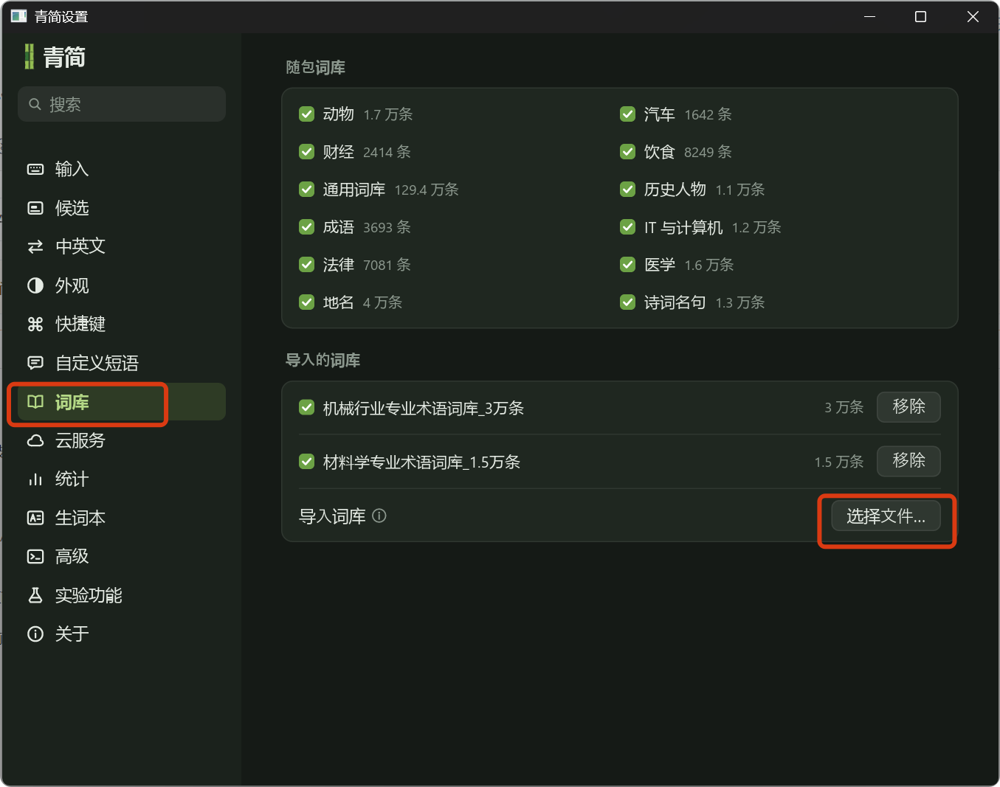

# 青简词库

青简输入法（[qingjian.app](https://qingjian.app)）的成品词库合集。

这些词库均由 AI 通过[词库制作技能包](#四词库制作技能包)生成。仓库同时充当**案例库**：
想做一个新领域的词库，可以直接从这里取用现成词库，或对照它们的口径、构词方式与说明文档版式。

## 一、词库清单

| 词库 | 条数 | 文件 | 覆盖范围 |
|---|---|---|---|
| 机械行业专业术语词库_3万条 | 30,314 | `.tsv` + `.dict.yaml` | 紧固件、键、齿轮、轴承、加工工艺（车铣刨磨、热处理、焊接、铸造）、材料、量具与检测 |
| 材料学专业术语词库_1.5万条 | 14,976 | `.tsv` + `.dict.yaml` | 晶体结构与相变、缺陷与扩散、力学性能与失效、表征试验、金属／陶瓷玻璃／高分子／复合材料、电池与半导体、腐蚀防护 |
| 数学专业术语词库_1万条 | 10,257 | `.tsv` + `.dict.yaml` | 小学到大学本科：算术与数、平面与立体几何、代数式与方程、函数与三角、数列与极限、导数与积分、级数、线性代数、概率统计、复变与微分方程、实变与泛函、抽象代数、拓扑、数论、数值分析、运筹与图论、数理逻辑与集合 |

每个词库都提供 `.tsv` 与 `.dict.yaml` 两个文件，选一个导入即可：`.tsv` 为通用文本词库，`.dict.yaml` 为 Rime 格式。

## 二、安装

1. 克隆仓库（Gitee 主仓，GitHub 为同步镜像，两边内容一致）：

   ```bash
   git clone https://gitee.com/seaworld/qingjian-vocabulary-bank.git

   # 或从 GitHub 镜像克隆
   git clone https://github.com/seaworld92/qingjian-vocabulary-bank.git
   ```

2. 打开青简输入法 → 设置 → 词库 → 导入，选择对应的 `.tsv` 文件：

   

3. 导入后建议重启输入法，让新词生效。

## 三、格式说明

- 每行三列，Tab 分隔：`词 ⟶ 拼音 ⟶ 词频`
- 拼音**音节间用空格分隔**、不带声调，`ü` 一律写作 `v`（如「铝」`lv`、「率」`lv`）
- 词频区间 800–10039，五档：7600 / 5200 / 3200 / 1700 / 800；同词同档恒定，便于跨库比对（数学库只用到 1700 以上四档）
- 文件编码 UTF-8（无 BOM）、LF 换行

⚠️ **机械行业词库的 `.dict.yaml` 是早期口径**：code 列写成连续拼音（`duihan`）。青简按「第二列有无空格」判定形态，
连续字母会被当成五笔词库导入。导入该库请优先用 `.tsv`；若一定要用 yaml，先用技能包重出一份。

## 四、词库制作技能包

技能包地址：<https://skillhub.cn/skills/user_7ce48f6f/qingjian-dict-skillhub>

把下面这句发给你的 AI，即可安装：

```text
请根据 https://skillhub.cn/install/skillhub.md，安装 @user_7ce48f6f/qingjian-dict-skillhub
```

技能支持拼音库、五笔库（86）与双库三种形态：给出领域和零件／设备清单就能展开词族，也可导入现成词表；
自动完成注音注码、词频分级、去重排序，输出 TSV、Rime dict.yaml 与统计说明文档，并按青简官网规则校验格式。

**1.0.3 起**，技能内置本案例库的取用方式——AI 会先看这里有没有同类词库，能省掉「猜口径」与「从头攒词」两步。
**1.0.4** 补齐数学语境的词组定音（奇函数 / 行列式 / 重积分三系多音字与「着色 zhuo se」），
并把说明文档的多音字示例改为项目可配置，不再把上一领域的示例带进新词库。

## 五、新增词库

新词库通过技能包生成、`validate` 校验通过后，把 `<标题>_<量级>.tsv` 与 `.dict.yaml` 放到仓库根目录，
并在「词库清单」与「更新记录」各补一行。维护者直接提交到 `master`，外部贡献者提交 PR 即可。
也可提 Issue 说明需要的领域，由维护者生成。

## 六、更新记录

| 日期 | 内容 |
|---|---|
| 2026-10-24 | 机械与材料库按标准读音重出，订正 874 条（弹 tán、泊松 bó、着色 zhuó） |
| 2026-10-24 | 采用 MIT 协议，仓库根目录加入 LICENSE |
| 2026-10-24 | 新增数学专业术语词库 1 万条；技能包升至 1.0.4，补齐数学语境定音 |
| 2026-10-24 | 新增材料学专业术语词库 1.5 万条；技能包升至 1.0.3，接入案例库 |
| 2026-10-23 | 建立仓库，收录机械行业专业术语词库 3 万条 |

## 许可

本项目采用 **MIT 协议**，全文见 [LICENSE](LICENSE)。可自由用于个人与商业输入法，也可修改与再分发，保留版权声明与许可声明即可。
词库中的专业术语属各领域公有知识，不单独主张版权。